# aiperf_dgx_spark_260917

Raw AIPerf benchmark results for **14 LLMs** served with vLLM on an **NVIDIA DGX Spark**
(GB10, 128 GB unified memory), run 2026-09-12 to 2026-09-13.

Generated with [aiperf_tool](https://github.com/mwolf-pi3g/aiperf_tool).
Analysis of these results can be found on our blog: https://pi3g.com/blog/

Related result sets from the DGX Station:
[aiperf_dgx_station_260918](https://github.com/mwolf-pi3g/aiperf_dgx_station_260918) (same
14 models plus 6 more) and
[aiperf_dgx_station_260919](https://github.com/mwolf-pi3g/aiperf_dgx_station_260919).

---

## Models tested

| Model | Concurrency levels |
|---|---|
| google/gemma-4-26B-A4B-it | 1, 2, 4, 8, 16, 32 |
| google/gemma-4-E4B-it | 1, 2, 4, 8, 16, 32 |
| google/gemma-4-E4B-it-qat-w4a16-ct | 1, 2, 4, 8, 16, 32 |
| ibm-granite/granite-4.2-30b | 1, 2, 4, 8, 16, 32 |
| Inferact/Qwen3.8-27B-NVFP4 | 1, 2, 4, 8, 16, 32 |
| nvidia/NVIDIA-Nemotron-3-Super-120B-A12B-NVFP4 | 1, 2, 4, 8, 16 |
| nvidia/NVIDIA-Nemotron-3.5-Lightning-30B-A3B-NVFP4 | 1, 2, 4, 8, 16, 32 |
| nvidia/Qwen3.6-27B-NVFP4 | 1, 2, 4, 8, 16, 32 |
| nvidia/Qwen3.6-35B-A3B-NVFP4 | 1, 2, 4, 8, 16, 32 |
| Qwen/Qwen3.6-27B | 1, 2, 4, 8, 16, 32 |
| Qwen/Qwen3.6-35B-A3B | 1, 2, 4, 8, 16, 32 |
| Qwen/Qwen3.8-27B | 1, 2, 4, 8, 16, 32 |
| Qwen/Qwen3.8-27B-FP8 | 1, 2, 4, 8, 16, 32 |
| unsloth/Qwen3.8-27B-NVFP4 | 1, 2, 4, 8, 16, 32 |

---

## Test setup

- vLLM image `vllm/vllm-openai:v0.29.0` for all models
- AIPerf 0.12.0
- 1024 input / 512 output tokens per request (fixed length, `ignore_eos:true`)
- 300 s per concurrency level, 2 profile runs per level, random seed 42
- Per-model vLLM flags in `conf/model_compose_overrides/`; per-model AIPerf inputs in the
  model config JSON

---

## Contents

| Path | Content |
|---|---|
| `artifacts/<timestamp>_<model>_c<levels>/` | One folder per model (14) |
| `…/aggregate/concurrency_<N>/profile_export_aiperf_aggregate.{json,csv}` | Aggregated metrics per concurrency level |
| `…/aggregate/sweep_aggregate/` | Metrics across the sweep |
| `…/concurrency_<N>/` | Raw AIPerf exports per concurrency level |
| `…/plots/` | Auto-generated plots and `summary.txt` |
| `conf/base_compose.yaml` | Shared Docker Compose base |
| `conf/model_compose_overrides/` | The 14 per-model vLLM overrides used |
| `conf/spark_models0.json` | Model config for all 14 models (the run was started with this file) |
| `logs/` | `container_setup` logs, 2026-09-10 to 2026-09-12 |
| `model_bringup.json` | Container start-to-ready times |
| `app_versions.txt` | Installed packages on the Spark (`apt list --installed`) |

---

## Notes

- The override files match the command lines of the containers that were benchmarked
  (checked against the containers still present on the Spark).
- `app_versions.txt` was recorded on 2026-10-26, after the test runs.
- `logs/` and `model_bringup.json` also contain entries for two smoke-test models
  (Qwen2.5-0.5B-Instruct, Qwen3-0.6B) and earlier bring-up attempts that are not part of
  this result set.

---

## Quick Takeaways

Pareto curve per model: output token throughput per GPU vs. per-user interactivity (generated by `aiperf plot`).

### google/gemma-4-26B-A4B-it

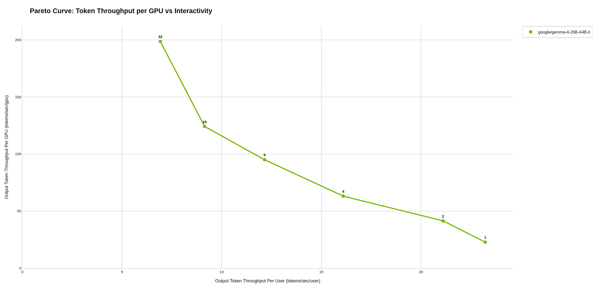

### google/gemma-4-E4B-it

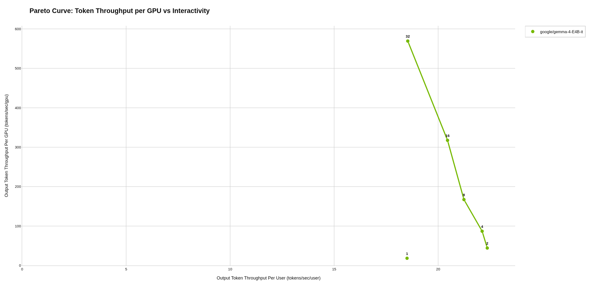

### google/gemma-4-E4B-it-qat-w4a16-ct

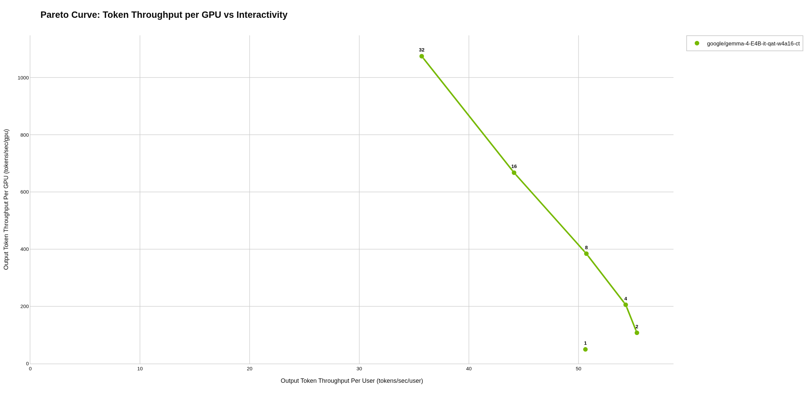

### ibm-granite/granite-4.2-30b

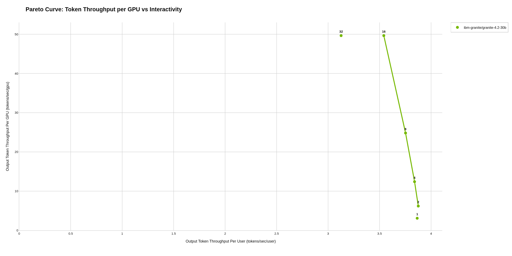

### Inferact/Qwen3.8-27B-NVFP4

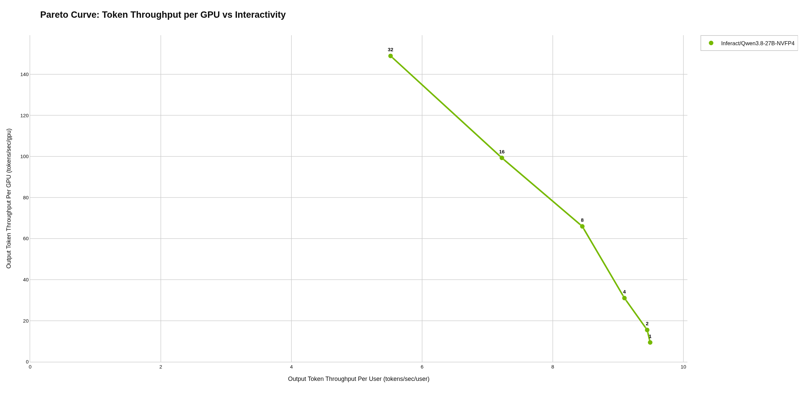

### nvidia/NVIDIA-Nemotron-3-Super-120B-A12B-NVFP4

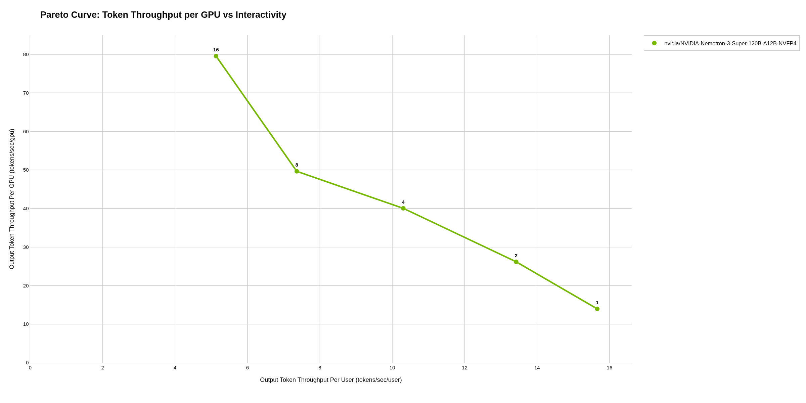

### nvidia/NVIDIA-Nemotron-3.5-Lightning-30B-A3B-NVFP4

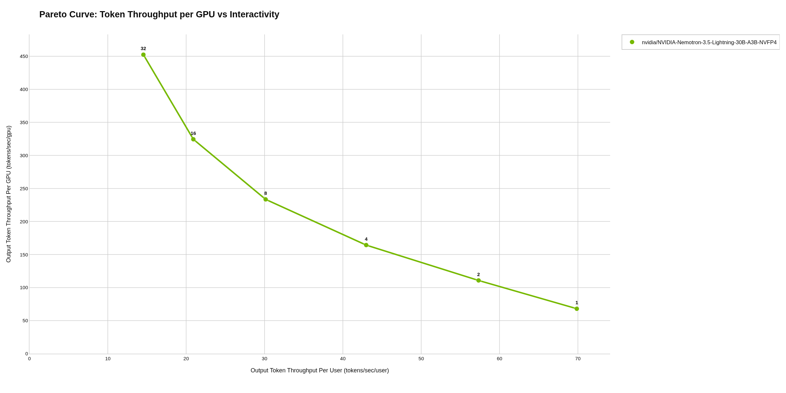

### nvidia/Qwen3.6-27B-NVFP4

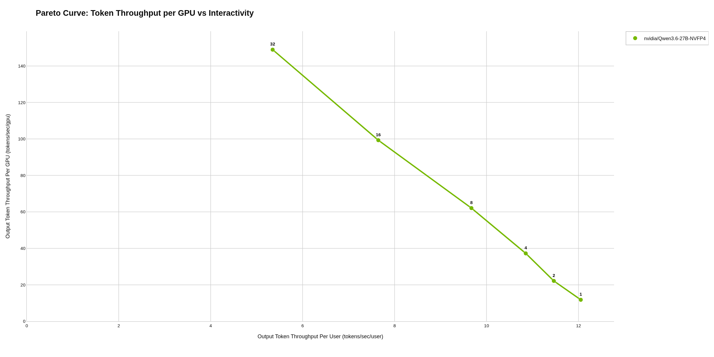

### nvidia/Qwen3.6-35B-A3B-NVFP4

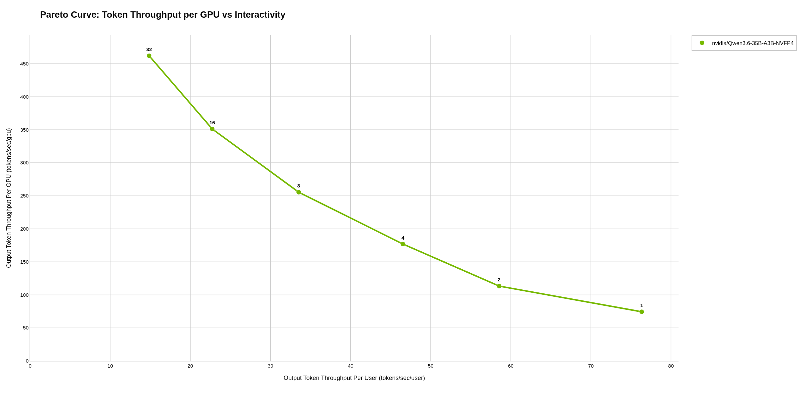

### Qwen/Qwen3.6-27B

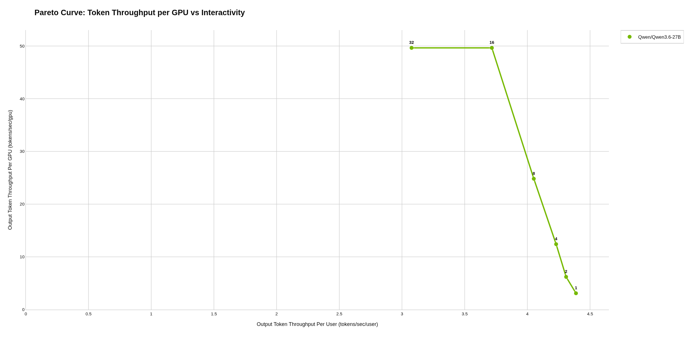

### Qwen/Qwen3.6-35B-A3B

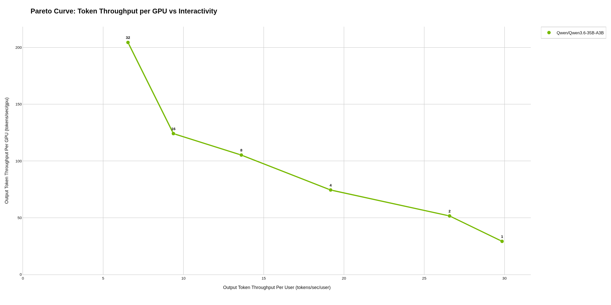

### Qwen/Qwen3.8-27B

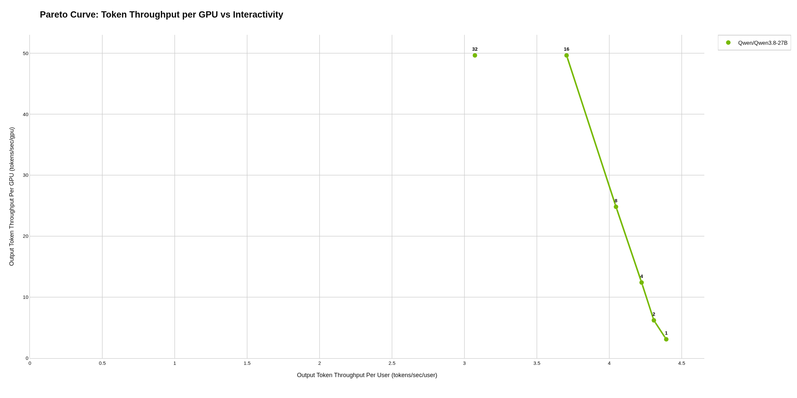

### Qwen/Qwen3.8-27B-FP8

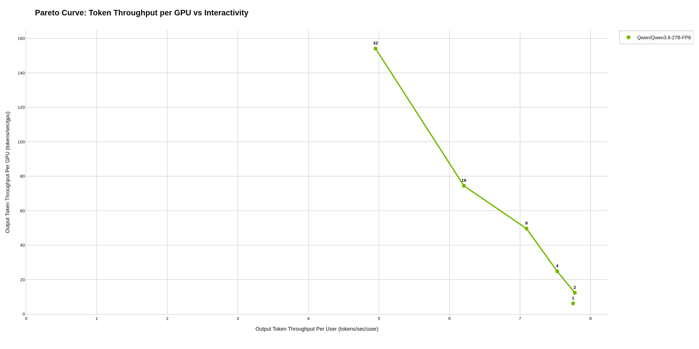

### unsloth/Qwen3.8-27B-NVFP4

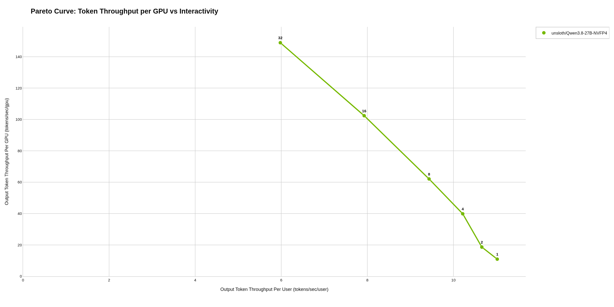
